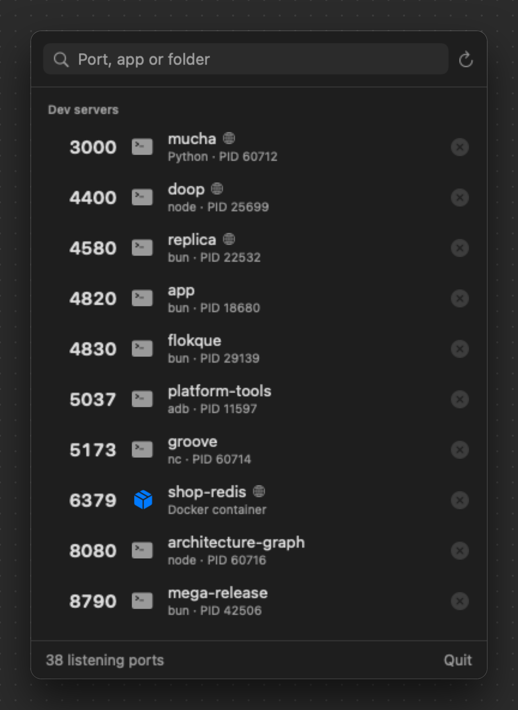
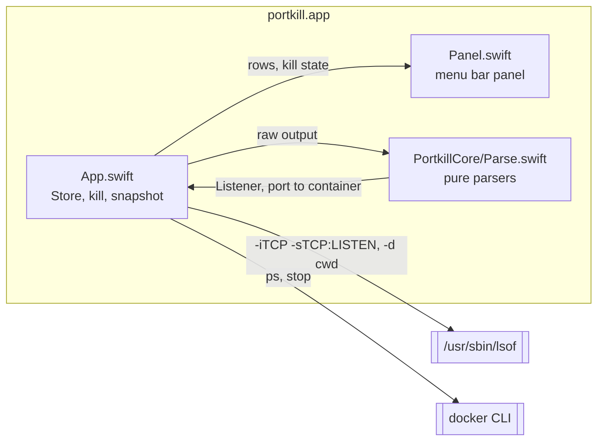

# portkill

<p align="center"><a href="https://preacherxp.github.io/30-days-of-tools/"></a></p>

<p align="center"><a href="https://buymeacoffee.com/michal.hachula"></a></p>

A macOS menu bar app that shows every port something is listening on, which project or container owns it, and stops it with one click.

`Error: listen EADDRINUSE :::3000` usually means hunting through `lsof` output for a PID. portkill keeps the number of listening ports in the menu bar. Click it and you get a list sorted by port, with dev servers at the top named after the folder they were started from (`mucha`, `groove`), and Docker containers named after the container. Click the cross next to one to stop it: processes get `SIGTERM`, and a **Force Quit** button appears if they're still running 2 seconds later. Containers get `docker stop`.

<p align="center"></p>

## Requirements

- macOS 14 or later
- Xcode 16 or later to build it
- Docker Desktop, OrbStack or another `docker` CLI, only if you want containers named

## Install

```sh
git clone https://github.com/preacherxp/portkill.git
cd portkill
scripts/bundle.sh
cp -R portkill.app /Applications/
open /Applications/portkill.app
```

`scripts/bundle.sh` builds a universal (Apple silicon and Intel) `portkill.app`, signed ad hoc. It has no Dock icon; look for the network icon and a number in the menu bar. To start it at login, add it in **System Settings** > **General** > **Login Items**.

To update, `git pull` and run the same commands again. To uninstall, choose **Quit** in the panel and delete `/Applications/portkill.app`. It writes no settings or caches.

## Usage

Click the menu bar icon to open the panel. It refreshes every time it opens, and every 10 seconds in the background to keep the count current. Type in the search field to filter by port, process, folder or container name.

| Key | Action |
| --- | --- |
| `⌘R` | Refresh the list |
| `⌘Q` | Quit portkill |
| Right click a row | **Copy localhost:PORT** or **Open in Browser** |

- **Dev servers.** Processes started from a folder, named after that folder, plus Docker containers. Hover a row to see the full path.
- **Apps and system.** Everything running from `/`: GUI apps, with their icons, and system daemons such as AirPlay on 5000 and 7000.
- **Globe icon.** The port is bound to every interface (`*`, `0.0.0.0` or `::`), so other machines on your network can reach it. No globe means loopback only.
- **Stop.** The cross sends `SIGTERM`. If the process is still alive after 2 seconds, the cross turns into **Force Quit**, which sends `SIGKILL`. For a container it runs `docker stop <name>` instead of killing Docker's own port forwarder, which would take every container down with it. Errors such as "Operation not permitted" show in red under the row.

Nothing leaves your Mac. portkill runs `lsof` and `docker ps` locally and keeps nothing on disk.

## Limits

- TCP listeners only. UDP ports and Unix sockets aren't shown.
- It runs as you, so it can't see or stop processes owned by root or other users, such as a system wide nginx on port 80.
- Containers are matched by published host port. A container that isn't publishing a port shows up as the Docker engine process, if at all.
- The menu bar count can lag by up to 10 seconds; opening the panel always refreshes it.

## Architecture



- **`Sources/portkill/Panel.swift`** is the SwiftUI panel shown by a `MenuBarExtra` in window style, so it gets the system's popover material, accent colour and dark mode for free.
- **`Sources/portkill/App.swift`** holds the `Store`: it runs `lsof` for listeners, a second `lsof` for each process's working directory, and `docker ps` for published ports, all off the main thread. GUI apps don't inherit your shell's `PATH`, so it looks for `docker` in `/usr/local/bin`, `/opt/homebrew/bin`, Docker Desktop's bundle, `~/.docker/bin` and `~/.orbstack/bin` too.
- **`Sources/PortkillCore/Parse.swift`** turns `lsof -F` field output and `docker ps` port strings into values. IPv4 and IPv6 sockets on the same port merge into one row; port ranges such as `8000-8002->8000-8002/tcp` expand; UDP mappings are ignored.

portkill changes nothing on your system except the processes and containers you stop.

## Development

```sh
swift build                                       # debug build
swift test                                        # parser tests
swift run portkill                                # run from the terminal
.build/debug/portkill --snapshot docs/portkill.png   # render the panel with live data to a 2x PNG
scripts/bundle.sh                                 # universal portkill.app
```

The version number lives in `scripts/bundle.sh`'s `Info.plist`. The README screenshot comes from `--snapshot`, which renders the real panel off screen in dark mode, so it needs no screen recording permission.

## License

[MIT](LICENSE)

<sub>If it saves you one more `lsof -i :3000`, you can [buy me a coffee](https://buymeacoffee.com/michal.hachula).</sub>
